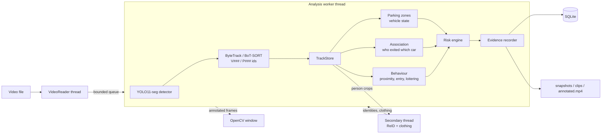
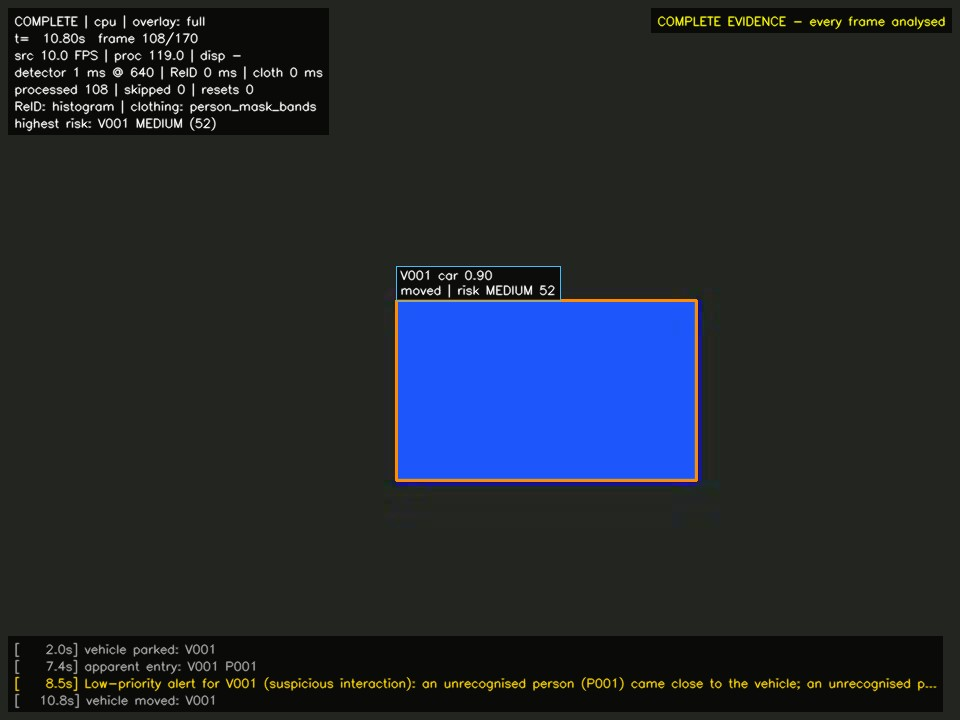

# Vehicle Theft Detection (prototype)

A desktop tool that watches a **prerecorded** car-park video and flags
situations worth a human look: someone hanging around a parked car, someone who
seems to get into it, and the car then driving off. It shows everything in an
OpenCV window while it works and saves snapshots, short clips and a database of
what it saw.

It is a prototype. It does not prove anything about anyone. It points a person
at the parts of the footage worth checking.

## What it does

1. Reads a video file frame by frame (MP4, AVI, MOV, whatever your OpenCV build decodes).
2. Runs **YOLO11 instance segmentation** on the GPU: one pass gives a box, a class
   and a pixel mask for every person, car, motorcycle, bus, truck and bicycle.
3. **Tracks** objects with ByteTrack (or BoT-SORT) and gives them separate IDs:
   vehicles `V001, V002…`, people `P001, P002…`.
4. Works out **who got out of which car**: a person whose track starts right
   beside a stationary car and then walks away is linked to that car, with a
   confidence score. People walking past are not linked. Unclear cases stay "ambiguous".
5. Describes each person's **clothing** (upper/lower colour, garment type) with
   a SegFormer human-parsing model, and computes **re-identification** embeddings so
   someone who leaves and comes back can be reconnected to their earlier ID.
6. Follows each vehicle through **parked → moved → left zone → departed** using
   optional parking-zone polygons you draw yourself.
7. Scores **risk per vehicle** with simple, explainable rules (unrecognised person
   near the car, apparent entry, car moving afterwards…) that accumulate and decay over time.
8. Saves **evidence**: snapshot, a clip with a few seconds before and after,
   a JSON log, rows in SQLite, and a full annotated copy of the video.

## Main features

* Instance masks, boxes, IDs, "exited V001" association labels and clothing colours drawn on the video
* Two processing modes: **responsive preview** (keeps up with the video, may skip
  frames, counts every skip) and **complete evidence** (analyses every frame, takes as long as it needs)
* Explainable risk levels: INFORMATIONAL, LOW, MEDIUM, HIGH, CRITICAL
* Local SQLite registry of vehicles and authorised people, kept separate from what the camera observed
* Interactive zone editor, keyboard controls, frame-accurate timestamps
* Everything stays on your machine

## Architecture



More detail: [docs/SYSTEM_ARCHITECTURE.md](docs/SYSTEM_ARCHITECTURE.md).

## Example output

Real output of this app on a public car-park clip (Intel `sample-videos`,
CC BY 4.0), complete-evidence mode on an RTX 5050 laptop GPU:


The image below is from the **synthetic test scene** used by the automated tests
(coloured rectangles stand in for detections). It shows what an alert looks like;
it is not real footage:



To capture your own screenshot, press **S** while the window is open; it goes to
`evidence/<session>/snapshots/`.

## Requirements

| | Tested with | Notes |
|---|---|---|
| OS | Windows 11 | Windows 10 should work the same |
| Python | 3.12.10 | 3.11 should work (numpy < 2.5), not tested |
| GPU | NVIDIA RTX 5050 Laptop, 8 GB, driver 595.71 | peak GPU memory measured ~1.1 GB reserved, so a 4 GB card (e.g. RTX 3050 laptop) should fit; not tested on one |
| PyTorch | 2.9.1 + CUDA 12.8 | CPU works but is slow |
| RAM | 16 GB | RAM use was not measured |
| Disk | ~6 GB | PyTorch CUDA wheels are large |

## Setup on Windows

Open the project folder in VS Code and use a PowerShell terminal.

**1. Create and activate a virtual environment**

```powershell
py -3.12 -m venv .venv
.\.venv\Scripts\Activate.ps1
python -m pip install --upgrade pip
```

If PowerShell refuses to run the activate script, run
`Set-ExecutionPolicy -Scope CurrentUser RemoteSigned` once, or use `.\.venv\Scripts\activate.bat` from `cmd`.

> Keep the project in a short path such as `C:\projects\vehicle-theft-detection`.
> Very long paths (over ~200 characters) make PyTorch fail to load its CUDA DLLs
> with `WinError 206`.

**2. Install PyTorch with CUDA (do this first)**

```powershell
pip install -r requirements-gpu.txt
```

This installs CUDA 12.8 builds, which cover GTX 10-series up to RTX 50-series.
If you need a different CUDA version, pick the command from the official selector:
<https://pytorch.org/get-started/locally/>

**3. Install the rest**

```powershell
pip install -r requirements.txt
```

**4. Download the models**

```powershell
python scripts/download_models.py --all
```

This fetches YOLO11-S-seg from the Ultralytics release assets, the SegFormer
clothing parser from Hugging Face and the torchvision ResNet-50 weights, then
runs a quick check on each and writes `models/model_status.json`. The better
OSNet ReID model needs a manual step, see [docs/MODEL_REQUIREMENTS.md](docs/MODEL_REQUIREMENTS.md).

**5. Check the GPU**

```powershell
python scripts/check_environment.py
```

You want to see `CUDA usable: yes` and the detector listed as `present verified=True`.

## Running it

```powershell
python -m app.main --video "C:\path\to\parking_video.mp4"
```

Run `python -m app.main` with no `--video` and a file picker opens.

Useful options:

| Option | Meaning |
|---|---|
| `--mode complete` | analyse every frame (for evidence); default is `responsive` |
| `--no-display` | no window, just process and save |
| `--zones configs\zones.json` | use a zone file |
| `--weights models\yolo11n-seg.pt` | faster, smaller detector |
| `--max-frames 500` / `--start-frame 1200` | process part of a video |
| `--no-reid` / `--no-clothing` | turn the secondary models off |
| `--device cpu` | force CPU |

Optional: draw parking, restricted and exit zones once per camera view:

```powershell
python -m app.zone_editor --video "C:\path\to\parking_video.mp4"
```

### Keyboard controls (in the video window)

| Key | Action |
|---|---|
| `Q` or `Esc` | quit (closing the window also quits) |
| `Space` | pause / resume |
| `S` | save a snapshot of the current frame |
| `R` | cycle overlays: full → boxes only → masks only → minimal |

## Where the output goes

```
evidence/
  vtd.sqlite3                    all sessions, events, associations, registry
  <session-id>/
    session.json                 video info, settings, final stats, frame accounting
    events.jsonl                 one line per alert
    annotated.mp4                annotated copy of the video (the source is never touched)
    snapshots/                   alert and manual snapshots (JPEG)
    clips/                       pre/post-event clips (MP4)
    profiles_<backend>.npz       appearance embeddings (if enabled in settings)
```

Browse results with `python -m app.manage sessions`, `events --session <id>` and
`associations`. See [docs/USER_GUIDE.md](docs/USER_GUIDE.md).

## Tests

```powershell
python -m pytest
```

101 tests, all passing on the machine above. Most use synthetic videos, scripted tracks and
simple stand-in detectors, so they test the software logic, not model accuracy. A few
smoke tests use the real downloaded models and are skipped if the weights are missing.
Details and real measurements: [docs/TESTING.md](docs/TESTING.md), [docs/PERFORMANCE.md](docs/PERFORMANCE.md).

### Measuring accuracy on your own footage

Accuracy has to be measured on labelled video of *your* car park. Process the video in complete
mode, write a small label file (copy `configs/labels_template.json`), then:

```powershell
python scripts/evaluate_session.py --session <session-id> --labels path\to\labels.json
```

It reports exit-association recall and vehicle accuracy, entry / movement / departure recall and
precision, incident recall and false alerts per hour, each with a 95 % confidence interval.
The criteria, sample sizes and protocol are in [docs/VALIDATION.md](docs/VALIDATION.md).

`python scripts/run_scenarios.py` replays eight scripted situations (walk-pasts, occlusion,
owner returning, theft…) through the rules. It is a regression check, not an accuracy measure.

## Troubleshooting

| Problem | Fix |
|---|---|
| `CUDA usable: no` / `CPU-only build` | You installed CPU PyTorch. `pip uninstall torch torchvision`, then `pip install -r requirements-gpu.txt`. |
| `WinError 206 ... c10_cuda.dll` | Project path too long. Move it to something like `C:\projects\vtd`. |
| `sm_120 is not compatible` or CUDA kernel errors on an RTX 50-series card | You need a CUDA 12.8+ PyTorch build (the one in `requirements-gpu.txt`). Update the NVIDIA driver too. |
| `Detector weights not found` | `python scripts/download_models.py --detector` |
| `is a 'detect' model, not an instance-segmentation model` | Use a `*-seg.pt` checkpoint. |
| `OpenCV could not open ...` | Unusual codec. Re-encode: `ffmpeg -i in.mov -c:v libx264 out.mp4`. |
| Window does not appear | `pip uninstall opencv-python-headless` then `pip install opencv-python==4.14.0.94` (the headless build has no GUI). |
| Many skipped frames in responsive mode | Expected when the GPU is slower than the video. Use `--mode complete`, `--weights models\yolo11n-seg.pt`, or `--no-clothing`. |
| `out of memory` on a 4 GB card | Use `yolo11n-seg.pt`, `--imgsz 512`, or `--no-clothing`. |
| PowerShell blocks `Activate.ps1` | `Set-ExecutionPolicy -Scope CurrentUser RemoteSigned` |

## Limitations

* Distances are in pixels, not metres. Camera angle changes how close "close" looks.
* "Got out of the car" and "got into the car" are inferred from where tracks start
  and end. Someone hidden behind a car can still look like they got in if they do not
  re-appear within a few seconds.
* The default ReID backend here is a generic ImageNet ResNet-50, not a trained
  person-ReID model, so reconnections are conservative and authorisation matching is
  off until OSNet is installed.
* There is no number-plate reading. A registered vehicle is linked to the parking zone it normally uses.
* Association and alert accuracy have **not** been measured on real staged footage yet. The tool
  to measure them exists; the labelled footage does not (see docs/VALIDATION.md).

Planned next steps are in [docs/PROJECT_OVERVIEW.md](docs/PROJECT_OVERVIEW.md#future-work).
Privacy notes: [docs/LIMITATIONS_AND_PRIVACY.md](docs/LIMITATIONS_AND_PRIVACY.md).

## Licence note

The detector is Ultralytics YOLO11 (AGPL-3.0). If you distribute this project you
must follow AGPL terms or get an Ultralytics commercial licence. The clothing model
and the datasets behind the pretrained weights have their own terms; see
[docs/MODEL_REQUIREMENTS.md](docs/MODEL_REQUIREMENTS.md).
