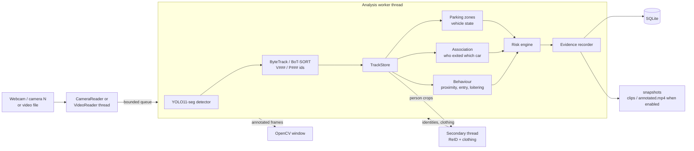
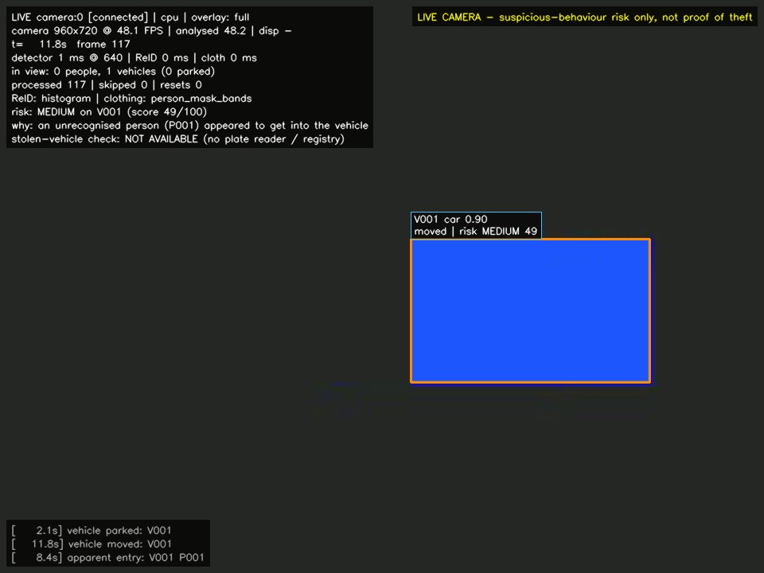
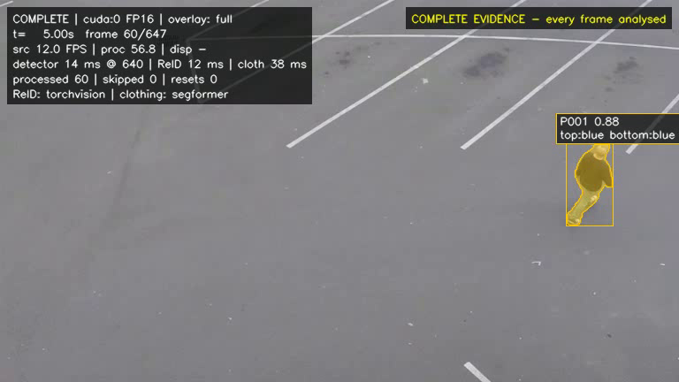
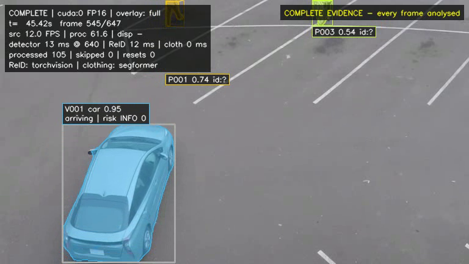

# Vehicle Theft Detection (prototype)

A desktop tool that watches a **live camera** (your laptop webcam by default) and
flags situations worth a human look: someone hanging around a parked vehicle, someone
who seems to get into it, and the vehicle then driving off. It shows the live feed with
detections, tracking IDs and an explained risk level in an OpenCV window. A prerecorded
video can still be analysed with `--video`.

It is a prototype. It does not prove anything about anyone. It points a person
at the moments worth checking.

## Quick start: live webcam

In the VS Code terminal (PowerShell), on the development laptop:

```powershell
cd E:\vehicle-theft-detection
C:\Users\Dharshan\.venvs\vtd\Scripts\python.exe run_webcam.py
```

`run_webcam.py` works from any folder, so this also works without the `cd`:

```powershell
C:\Users\Dharshan\.venvs\vtd\Scripts\python.exe E:\vehicle-theft-detection\run_webcam.py
```

On another machine, use your own environment's `python.exe` and project path; the
equivalent from inside the project folder is `python -m app.main` (with the environment active).

What you should see:

1. Within a few seconds a window opens showing the **raw camera picture** with
   "LIVE CAMERA camera:0 - starting / Loading AI models..." on top.
2. About 10–20 s later (model loading and GPU warm-up) the analysis starts: boxes, masks,
   `P001`/`V001` IDs, the status panel and the "LIVE CAMERA - ... not proof of theft" banner.
3. Press **Q** or **Esc**, or close the window, to quit. The camera is released.

Other cameras: add `--camera 1`. In VS Code you can also press F5 with **"LIVE WEBCAM (camera 0)"**
selected in Run and Debug. The entries starting with **"PRERECORDED VIDEO"** analyse a file instead
of the webcam.

Risk alerts only appear when the existing rules see the pattern they look for: a **vehicle** that
has been standing still for 3 s, a person lingering next to it, the person overlapping it and
disappearing, then the vehicle moving. A laptop webcam pointed at a room will show people being
detected and tracked with `risk: none`, which is the correct result there, not a fault.

### What it can and cannot tell you

| Level | What it means | Status |
|---|---|---|
| 1. Detection | people, cars, motorcycles/scooters, buses, trucks and bicycles in view, with tracking IDs | implemented (COCO-trained YOLO11) |
| 2. Suspicious behaviour | lingering near a parked vehicle, apparently getting in, the vehicle then moving or leaving, scored with reasons | implemented (rule-based, explainable, **not** validated on real staged footage) |
| 3. Stolen-vehicle verification | confirming that a specific vehicle is reported stolen | **not implemented**: it would need a reliable vehicle identifier (a number-plate reader, none is included) and access to an authorised stolen-vehicle database (none is connected). The window says so permanently. |

A HIGH alert therefore means "a person should look at this", never "this vehicle was stolen".

## What it does

1. Reads frames from the webcam (or any camera by index) live, or from a video file.
2. Runs **YOLO11 instance segmentation** on the GPU: one pass gives a box, a class
   and a pixel mask for every person, car, motorcycle, bus, truck and bicycle.
3. **Tracks** objects with ByteTrack (or BoT-SORT) and gives them separate IDs:
   vehicles `V001, V002…`, people `P001, P002…`.
4. Works out **who got out of which car**: a person whose track starts right
   beside a stationary car and then walks away is linked to that car, with a
   confidence score. People walking past are not linked. Unclear cases stay "ambiguous".
5. Describes each person's **clothing** (upper/lower colour, garment type) with
   a SegFormer human-parsing model, and computes **re-identification** embeddings so
   someone who leaves and comes back can be reconnected to their earlier ID.
6. Follows each vehicle through **parked → moved → left zone → departed** using
   optional parking-zone polygons you draw yourself.
7. Scores **risk per vehicle** with simple, explainable rules (unrecognised person
   near the car, apparent entry, car moving afterwards…) that accumulate and decay over time.
8. Saves **evidence**: a snapshot for every MEDIUM+ alert, a JSON log and rows in SQLite.
   For video files it also saves pre/post clips and a full annotated copy; in live camera
   mode those are off unless you ask for them (`--alert-clips`, `--record`).

## Main features

* Live webcam input by default; pick another camera with `--camera N`
* Instance masks, boxes, IDs, "exited V001" association labels and clothing colours drawn on the feed
* A status panel with camera status, camera/analysis FPS, people and vehicles in view,
  current risk level and the reason for it
* For video files, two processing modes: **responsive preview** (keeps up with the video, may skip
  frames, counts every skip) and **complete evidence** (analyses every frame, takes as long as it needs)
* Explainable risk levels: INFORMATIONAL, LOW, MEDIUM, HIGH, CRITICAL
* Local SQLite registry of vehicles and authorised people, kept separate from what the camera observed
* Interactive zone editor, keyboard controls, frame-accurate timestamps
* Everything stays on your machine

## Architecture



More detail: [docs/SYSTEM_ARCHITECTURE.md](docs/SYSTEM_ARCHITECTURE.md).

## Example output

**Live camera mode** (the default). This picture was produced by the live-camera code path
(status panel, risk line with its reason, banner) fed with the **synthetic test scene** through a
simulated camera, because no real footage of a vehicle incident is included. Coloured rectangles
stand in for a car and a person; it is not real footage. With your webcam, the same panel and
labels are drawn over the real picture.



**Prerecorded video mode** (`--video`). These are older screenshots of the app analysing a public
car-park clip (Intel `sample-videos`, CC BY 4.0) in complete-evidence mode. They show what detection
and segmentation look like on real footage; they are **not** the live webcam view:





To capture your own screenshot, press **S** while the window is open; it goes to
`evidence/<session>/snapshots/`.

## Requirements

| | Tested with | Notes |
|---|---|---|
| OS | Windows 11 | Windows 10 should work the same |
| Python | 3.12.10 | 3.11 should work (numpy < 2.5), not tested |
| GPU | NVIDIA RTX 5050 Laptop, 8 GB, driver 595.71 | peak GPU memory measured ~1.1 GB reserved, so a 4 GB card (e.g. RTX 3050 laptop) should fit; not tested on one |
| PyTorch | 2.9.1 + CUDA 12.8 | CPU works but is slow |
| RAM | 16 GB | RAM use was not measured |
| Disk | ~6 GB | PyTorch CUDA wheels are large |

## Setup on Windows

Open the project folder in VS Code and use a PowerShell terminal.

**1. Create and activate a virtual environment**

```powershell
py -3.12 -m venv .venv
.\.venv\Scripts\Activate.ps1
python -m pip install --upgrade pip
```

If PowerShell refuses to run the activate script, run
`Set-ExecutionPolicy -Scope CurrentUser RemoteSigned` once, or use `.\.venv\Scripts\activate.bat` from `cmd`.

> Keep the project in a short path such as `C:\projects\vehicle-theft-detection`.
> Very long paths (over ~200 characters) make PyTorch fail to load its CUDA DLLs
> with `WinError 206`.

**2. Install PyTorch with CUDA (do this first)**

```powershell
pip install -r requirements-gpu.txt
```

This installs CUDA 12.8 builds, which cover GTX 10-series up to RTX 50-series.
If you need a different CUDA version, pick the command from the official selector:
<https://pytorch.org/get-started/locally/>

**3. Install the rest**

```powershell
pip install -r requirements.txt
```

**4. Download the models**

```powershell
python scripts/download_models.py --all
```

This fetches YOLO11-S-seg from the Ultralytics release assets, the SegFormer
clothing parser from Hugging Face and the torchvision ResNet-50 weights, then
runs a quick check on each and writes `models/model_status.json`. The better
OSNet ReID model needs a manual step, see [docs/MODEL_REQUIREMENTS.md](docs/MODEL_REQUIREMENTS.md).

**5. Check the GPU**

```powershell
python scripts/check_environment.py
```

You want to see `CUDA usable: yes` and the detector listed as `present verified=True`.

## Running it

### Live webcam (the normal way)

From the project folder, with the virtual environment active:

```powershell
python -m app.main
```

That opens camera 0 (the built-in webcam), loads the models (about 10–15 s the first
time in a session), and shows the live window. No video file is needed and nothing is
recorded except alert snapshots and the event database.

Without activating the environment, use its Python directly (adjust the path if your
virtual environment lives elsewhere):

```powershell
.\.venv\Scripts\python.exe -m app.main
```

| Option | Meaning |
|---|---|
| `--camera 1` | use another connected camera (0 = built-in webcam); also `camera.index` in settings |
| `--resolution 1280x720` | requested camera resolution (the driver picks the nearest it supports) |
| `--camera-backend msmf` | force a backend if the default (DirectShow, then Media Foundation) misbehaves |
| `--alert-clips` | also save short clips around MEDIUM+ alerts (off by default in live mode) |
| `--record` | also save the whole annotated feed (off by default) |
| `--no-display` | no window (headless test runs) |
| `--max-frames 600` | stop after that many camera frames |

What the status panel (top left) shows: camera status (`connected`, `waiting for frames`,
`paused`, `DISCONNECTED`), camera FPS vs analysed FPS, people and vehicles in view (and how
many vehicles are parked), detector/ReID/clothing latency, processed and skipped frames,
the highest current risk with the reason for it, and a permanent line saying stolen-vehicle
verification is not available. Recent events and alerts appear bottom left.

To see the risk logic do anything, a vehicle has to be in view and stay still for 3 s, then a
person has to linger next to it, overlap it and leave the view, and finally the vehicle has to
move. Pointing the laptop at a desk, you will normally only see people being detected and
tracked; risk stays at "none". (Whether a toy car or a car shown on another screen is detected
well enough to try this indoors has not been tested.)

If the camera cannot be opened the program exits with code 5 and says what to check
(another app using the camera, Windows camera privacy settings, wrong index).

### Prerecorded video (analysis and evaluation)

```powershell
python -m app.main --video "C:\path\to\parking_video.mp4" --mode complete
```

`--pick-video` opens a file dialog instead. Video-only options: `--mode responsive|complete`,
`--start-frame 1200`, `--no-save-video`.

### Common options

| Option | Meaning |
|---|---|
| `--zones configs\zones.json` | use a zone file |
| `--weights models\yolo11n-seg.pt` | faster, smaller detector |
| `--no-reid` / `--no-clothing` | turn the secondary models off |
| `--device cpu` | force CPU |

Optional: draw parking, restricted and exit zones once per camera view:

```powershell
python -m app.zone_editor --camera 0
python -m app.zone_editor --video "C:\path\to\parking_video.mp4"
```

### Keyboard controls (in the window)

| Key | Action |
|---|---|
| `Q` or `Esc` | quit safely (closing the window also quits); the camera is released |
| `Space` | pause / resume (the camera is not read while paused) |
| `S` | save a snapshot of the current frame |
| `R` | cycle overlays: full → boxes only → masks only → minimal |

## Where the output goes

```
evidence/
  vtd.sqlite3                    all sessions, events, associations, registry
  <session-id>/
    session.json                 source info, settings, final stats, frame accounting
    events.jsonl                 one line per alert
    annotated.mp4                annotated copy (video files; live camera only with --record)
    snapshots/                   alert and manual snapshots (JPEG)
    clips/                       pre/post-event clips (video files; live camera only with --alert-clips)
    profiles_<backend>.npz       appearance embeddings (if enabled in settings)
```

Live sessions are stored with source `camera:N` and mode `live`.

Browse results with `python -m app.manage sessions`, `events --session <id>` and
`associations`. See [docs/USER_GUIDE.md](docs/USER_GUIDE.md).

## Tests

```powershell
python -m pytest
```

127 tests, all passing on the machine above. Most use synthetic videos, scripted tracks,
a fake camera and simple stand-in detectors, so they test the software logic, not model
accuracy, and no webcam is needed. A few smoke tests use the real downloaded models and are
skipped if the weights are missing.
Details and real measurements: [docs/TESTING.md](docs/TESTING.md), [docs/PERFORMANCE.md](docs/PERFORMANCE.md).

### Measuring accuracy on your own footage

Accuracy has to be measured on labelled video of *your* car park. Process the video in complete
mode, write a small label file (copy `configs/labels_template.json`), then:

```powershell
python scripts/evaluate_session.py --session <session-id> --labels path\to\labels.json
```

It reports exit-association recall and vehicle accuracy, entry / movement / departure recall and
precision, incident recall and false alerts per hour, each with a 95 % confidence interval.
The criteria, sample sizes and protocol are in [docs/VALIDATION.md](docs/VALIDATION.md).

`python scripts/run_scenarios.py` replays eight scripted situations (walk-pasts, occlusion,
owner returning, theft…) through the rules. It is a regression check, not an accuracy measure.

## Troubleshooting

| Problem | Fix |
|---|---|
| `CUDA usable: no` / `CPU-only build` | You installed CPU PyTorch. `pip uninstall torch torchvision`, then `pip install -r requirements-gpu.txt`. |
| `WinError 206 ... c10_cuda.dll` | Project path too long. Move it to something like `C:\projects\vtd`. |
| `sm_120 is not compatible` or CUDA kernel errors on an RTX 50-series card | You need a CUDA 12.8+ PyTorch build (the one in `requirements-gpu.txt`). Update the NVIDIA driver too. |
| `Detector weights not found` | `python scripts/download_models.py --detector` |
| `is a 'detect' model, not an instance-segmentation model` | Use a `*-seg.pt` checkpoint. |
| `OpenCV could not open ...` | Unusual codec. Re-encode: `ffmpeg -i in.mov -c:v libx264 out.mp4`. |
| Window does not appear | `pip uninstall opencv-python-headless` then `pip install opencv-python==4.14.0.94` (the headless build has no GUI). |
| Many skipped frames in responsive mode | Expected when the GPU is slower than the video. Use `--mode complete`, `--weights models\yolo11n-seg.pt`, or `--no-clothing`. |
| `out of memory` on a 4 GB card | Use `yolo11n-seg.pt`, `--imgsz 512`, or `--no-clothing`. |
| PowerShell blocks `Activate.ps1` | `Set-ExecutionPolicy -Scope CurrentUser RemoteSigned` |
| I see the old prerecorded sample video, not my webcam | You started video mode. `--video`, `--pick-video` and the VS Code entries named "PRERECORDED VIDEO ..." analyse a file. Use the Quick start command (`run_webcam.py`) or the "LIVE WEBCAM (camera 0)" entry. The live window says `LIVE camera:0` top left; video mode says `RESPONSIVE`/`COMPLETE`. Old screenshots in this README and old files in `evidence/` are from video mode. |
| `No module named 'app'` | You ran `python -m app.main` outside the project folder. Run `run_webcam.py` by its full path (works anywhere), or `cd E:\vehicle-theft-detection` first. |
| `WARNING: no usable CUDA GPU` / very slow live view | You started it with a Python whose PyTorch is CPU-only (on the dev laptop, plain `python` is system Python 3.14 with `torch ...+cpu`). Use the project environment's `python.exe` as in the Quick start; the first line printed (`Python: ...`) shows which one is running. |
| Window opens but stays on "Loading AI models..." | Normal for 10–20 s (model load + GPU warm-up). It shows the raw camera meanwhile. Longer on battery. |
| `Camera 0 could not be used` | Close other apps using the camera (Camera, Teams, Zoom, browser tabs); check Windows Settings > Privacy & security > Camera > "Let desktop apps access your camera"; check the privacy shutter / camera key; try `--camera 1`. |
| Camera opens but shows `waiting for frames` or `stopped delivering frames` | Try `--camera-backend msmf`, a lower `--resolution 640x480`, or replug a USB camera. |
| Live view feels behind | It always analyses the newest frame; if the analysed FPS is low, try `--weights models\yolo11n-seg.pt`, `--no-clothing` or `--resolution 960x540`, and plug the laptop in (on battery the GPU runs much slower). |

## Limitations

* Distances are in pixels, not metres. Camera angle changes how close "close" looks.
* "Got out of the car" and "got into the car" are inferred from where tracks start
  and end. Someone hidden behind a car can still look like they got in if they do not
  re-appear within a few seconds.
* The default ReID backend here is a generic ImageNet ResNet-50, not a trained
  person-ReID model, so reconnections are conservative and authorisation matching is
  off until OSNet is installed.
* There is no number-plate reading and no stolen-vehicle database, so the system cannot say
  that a vehicle is stolen. A registered vehicle is linked to the parking zone it normally uses.
* Scooters are detected as `motorcycle` (COCO has no scooter class). Crowded Indian streets,
  night scenes and Indian number plates have **not** been tested.
* With a webcam close to people, person crops often touch the frame edge and are skipped for
  ReID/clothing, so those columns may stay empty in desk tests.
* Association and alert accuracy have **not** been measured on real staged footage yet. The tool
  to measure them exists; the labelled footage does not (see docs/VALIDATION.md).

Planned next steps are in [docs/PROJECT_OVERVIEW.md](docs/PROJECT_OVERVIEW.md#future-work).
Privacy notes: [docs/LIMITATIONS_AND_PRIVACY.md](docs/LIMITATIONS_AND_PRIVACY.md).

## Licence

This project's code is released under the **GNU Affero General Public License v3.0**
([LICENSE](LICENSE)), because it is built on Ultralytics YOLO11, which is AGPL-3.0. If you
modify it and distribute it, or let others use it over a network, you must make your source
available under the same licence (or obtain an Ultralytics commercial licence).

The licence covers this repository's code and documentation only. The model weights are not
included and keep their own terms (YOLO11: AGPL-3.0; SegFormer clothing model: "other"; ImageNet
and ReID datasets: research use), as does the Intel sample video (CC BY 4.0) that the example
screenshots come from. See [docs/MODEL_REQUIREMENTS.md](docs/MODEL_REQUIREMENTS.md).
