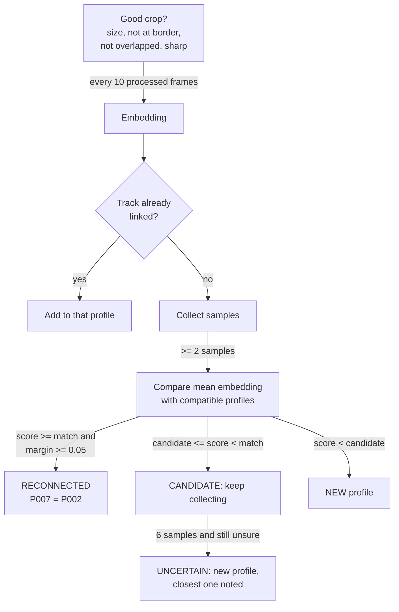
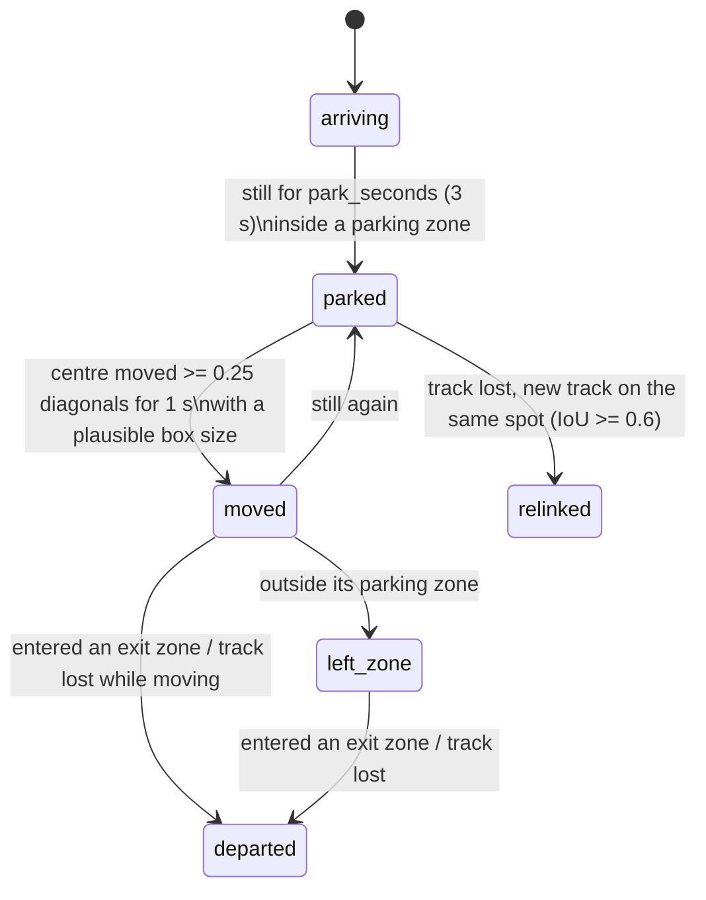

# How the analysis works

All thresholds below are defaults from `app/config.py`; every one can be changed in
`configs/settings.yaml`. None of them were tuned on real staged footage yet.

## 1. Detection and masks

YOLO11-S-seg runs once per processed frame at `imgsz` 640 (FP16 on CUDA after a
FP16-vs-FP32 agreement check). Only the configured classes are kept. For each detection
we keep the box, class, confidence and the mask outline polygon (`masks.xy`, already in
frame pixels). Degenerate outlines (< 3 points) are dropped instead of being replaced
with a fake mask.

Rendering blends all masks in one pass over the bounding region of the masks only,
and draws each outline in its own colour so overlapping people stay distinct.

## 2. Tracking

One Ultralytics tracker per group (vehicles, people, other), so a person box can never
continue a car track. Raw tracker ids are mapped to application ids by
`(group, epoch, raw id)` → `V001`, `P001`, …

* **Frame gaps**: if more than `max_gap_frames` (15) source frames passed since the last
  processed frame, the motion model is no longer valid, so the trackers are reset and the
  epoch increases. New ids are issued; ReID may reconnect people; parked cars are
  re-linked by position (see zones). Births right after a reset are never treated as exits.
* **Duplicates**: two same-group tracks with IoU ≥ 0.85 in one frame → the newer is dropped.
* **Lost / forgotten**: a track not seen for 1 s is *lost*; after 30 s it is forgotten.
* `track_buffer` is scaled from the YAML's 30 FPS assumption to the video's real FPS.

## 3. Vehicle-person association (who got out of which car)

The key observation: people who get out of a car **first appear** beside it. A person
walking past was already tracked before reaching the car, so their track was not born
there. Only new person tracks are considered.

At a person's first frame, every visible vehicle whose box, widened by `door_margin`
(25 % of its width each side, 12.5 % of its height), covers at least 35 % of the person's
box becomes a candidate. The person is then watched for `observation_seconds` (2.5 s).

Score per candidate:

| Component | Weight | Value |
|---|---|---|
| birth_overlap | 0.30 | fraction of the person's first box inside the widened vehicle box |
| door_zone | 0.15 | 1.0 if the first foot point is in a side band (lower part of the box), 0.8 in the bottom band, 0.4 elsewhere inside, else 0 |
| outward_motion | 0.25 | how far the foot point moved away from the vehicle box over the window (0.15 vehicle-diagonals = full score), × fraction of steps that did not move back |
| vehicle_stationary | 0.15 | 1.0 if the vehicle was still when the person appeared, else 0.2 |
| recent_arrival | 0.15 | 1.0 if we saw the vehicle come to rest within 120 s, 0.5 if arrival was not observed, 0.3 if it arrived long ago |

Penalties: ×0.5 if the track started touching the frame border (people walk in from
the edge); ×0.6 if another person track was lost within one body-height of this spot
in the last 2 s (probably the same person re-appearing from behind the car).

Decision, using the best and second-best scores:

* fewer than 4 observations → **none** ("too few observations")
* second ≥ 0.40 and best − second < 0.12 → **ambiguous**, no vehicle assigned
* best ≥ 0.60 → **observed_exit**
* best ≥ 0.40 → **possible_exit**, *except* when the re-appearance penalty applied: a weak
  score next to a person who just vanished is far more likely an occlusion, so → **none**
* otherwise → **none**

Each record stores the component scores, all candidates and plain-text reasons, and is
written to the `associations` table with `review_status = unreviewed`. A person can
review it with `python -m app.manage review-association`. Several people can be linked
to the same vehicle, each keeping their own id.

Example from the unit tests: a person appearing at the right door of a parked car and
walking right scores ≥ 0.6 → observed_exit; a person walking across in front of the car
from the far left → none, reason "did not first appear next to a vehicle"; a person
standing exactly between two cars → ambiguous.

## 4. Re-identification



* A profile's score is the mean of its top-3 cosine similarities to the query, nudged by
  clothing agreement: `± 0.10 × (2 × agreement − 1) × clothing quality`. Clothing can move
  the score a little but never decides on its own.
* **Incompatible profiles are excluded**: any profile with a track on screen in the last
  second, or whose tracks were ever on screen at the same time as this track.
* Thresholds depend on the backend (torchreid 0.70/0.55, ResNet-50 0.88/0.80, histogram
  0.92/0.85).
* Raw track ids are never rewritten. Decisions go to `identity_links` with score and backend.

## 5. Clothing

For a selected crop (at most every 30 processed frames per person, crop ≥ 96 px tall):

1. SegFormer labels every pixel; we keep only pixels inside the person's YOLO instance
   mask, so a neighbour's shirt is not counted.
2. Upper region = `Upper-clothes`; lower = whichever of `Pants` / `Skirt` is bigger; if
   `Dress` dominates, the dress is split into top/bottom halves.
3. Dominant colour = biggest of 3 k-means clusters, mapped to a coarse name with HSV rules
   (black/white/gray by brightness and saturation, then hue bins; brown and beige special-cased).
4. Pattern hint = Canny edge density inside the eroded upper region: `plain` < 0.06 <
   `unclear` < 0.15 < `patterned`. Only when the region has ≥ 2500 pixels.
5. Quality (0–1) = size × lighting × sharpness × mask fill, with notes like "low light",
   "blurry", "partly occluded". Colour confidence = cluster share × quality.

## 6. Parking state



Without a zone file the whole frame counts as one parking area, so "left zone" never
fires and departure comes from the track being lost while moving.

## 7. Behaviour events

Computed for each visible person × each **parked** vehicle:

* **proximity**: the person's foot point is inside the vehicle box widened by 60 % of its
  width each side **and** they have lingered there, i.e. spent ≥ 1.5 s moving slower than
  0.35 box diagonals per second (normal walking is about 1). Walking past never counts.
  While the association engine is still deciding whether this person just got out of the
  car, the event is held back, so a driver is not scored as a stranger against their own car.
  A new visit counts only after ≥ 3 s away.
* **repeated_interaction**: the 3rd separate lingering visit.
* **extended_presence**: one visit lasting ≥ 20 s (walking or not).
* **apparent_entry**: a person track is lost while ≥ 35 % of its box overlaps a vehicle
  and it is not at the frame border. It is then held for 3 s:
  * if a **new** person track starts within 1.5 body-heights of where they vanished, it was
    just someone hidden behind the car → withdrawn (counted as `apparent_entries_withdrawn`);
  * if the vehicle starts moving → confirmed immediately;
  * otherwise → confirmed after 3 s.
  The event keeps the time the person vanished. Confidence 0.4–0.8 depending on overlap,
  ×0.75 if the person never touched the car before vanishing.
* **restricted_area**: foot point inside a restricted zone (once per person and zone).

## 8. Risk scoring

```
points = weight[kind] × identity_factor × event_confidence
score(t) = min(100, score(t0) × 0.5^((t − t0) / 120 s) + points)
```

| Event | Weight | | Who | Factor |
|---|---|---|---|---|
| proximity | 10 | | registered & authorised for this vehicle | 0.0 |
| repeated_interaction | 20 | | seen getting out of this vehicle (observation only) | 0.3 |
| extended_presence | 15 | | ReID unsure, but best guess got out of this vehicle | 0.6 |
| | | | anyone else | 1.0 |
| apparent_entry | 30 | | vehicle moved, nobody seen getting in | 0.5 |
| restricted_area | 10 | | | |
| vehicle_moved | 20 | | | |
| vehicle_left_zone | 25 | | | |
| vehicle_departed | 20 | | | |

For movement events the factor comes from the *most suspicious* person who appeared to get
in during the last 120 s (including entries still waiting for confirmation). Levels: LOW ≥ 15,
MEDIUM ≥ 35, HIGH ≥ 55, CRITICAL ≥ 80.

A vehicle only counts as **moved** when its centre has been ≥ 0.25 diagonals from the parked
position for 1 s, in frames where the box area stayed within 0.6–1.67× the parked size (larger
changes are treated as someone standing in front of it), unless the displacement is very large
or the box touches the frame edge. A car that vanishes while starting to move still gets
`vehicle_moved` and `vehicle_departed`.

* **Cooldown**: the same (vehicle, event kind, person) cannot add points again within 20 s.
* **Alerts** are raised when the level goes up, or again at the same level after 60 s if
  new evidence arrived. When the score decays to a lower level, a later rise alerts again.
* **Text** lists up to three strongest recent reasons in order, e.g.
  *"Medium-priority alert for V001 (possible unauthorised vehicle movement): an unrecognised
  person (P001) came close to the vehicle; an unrecognised person (P001) appeared to get into
  the vehicle; the vehicle moved from its parking position after an unrecognised person
  (P001) appeared to get in."* (actual output from the synthetic test scene)

Worked example (synthetic scene): proximity 10 × 0.9 = 9 → apparent entry ≈ 24 → LOW
alert at 32; vehicle moved +20 → MEDIUM at 52; departure +12 → HIGH at 62.

## 9. Evidence

* The annotated frame is pushed into a ring buffer (last `pre_event_seconds`, 3 s, scaled
  to ≤ 960 px wide).
* An alert at or above `evidence.min_level` (MEDIUM) saves a full-resolution JPEG of the
  annotated frame and starts a clip: the buffered frames, then frames until
  `post_event_seconds` (5 s) later. A second alert for the same vehicle while its clip is
  open extends that clip instead of starting another.
* Every alert also goes to SQLite (`events`) and `events.jsonl` with frame number, video
  timestamp, ids, reasons, confidences, file paths and the frame counters at that moment.
* At shutdown, clips are closed, failed writes are reported and the DB path for a failed
  clip is cleared; the annotated video is reopened to confirm it is readable.
