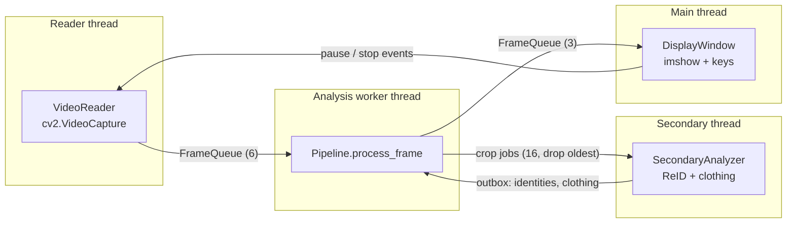
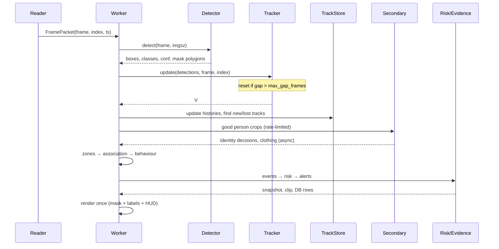
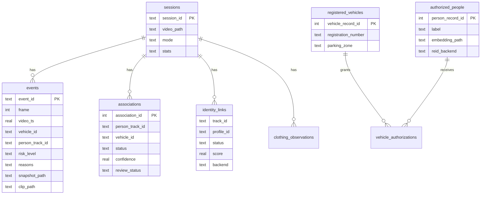

# System architecture

## Threads and queues

There are four threads. Only two things are shared between them: the bounded
queues and the person gallery (which has its own lock).

* **Reader**: one of two classes with the same interface.
  * `CameraReader` (`app/camera.py`, the default): reads the webcam continuously from a
    `CameraSource` that was opened once in `main.py` (DirectShow, then Media Foundation, then
    any backend; a real frame must arrive within `camera.open_timeout_seconds`). Each frame gets
    a running index and a wall-clock timestamp (seconds since capture started). It always keeps
    the newest frame (queue of `camera.queue_size`, 2), counts dropped frames as skipped, stops
    reading while paused, and raises `CameraError` after `camera.max_failed_reads` failed reads
    in a row (unplugged, disabled, taken by another app). The pipeline releases the camera on
    every exit path, including setup and analysis failures.
  * `VideoReader` (`app/video_reader.py`, with `--video`): decodes frames and stamps each one
    with its source frame number and timestamp (`index / fps`). In responsive mode it releases
    frames at the source frame rate and drops the oldest queued frame if the worker is behind.
    In complete mode it blocks instead.

  Everything after the reader (detector, tracker, association, zones, behaviour, risk,
  evidence) is identical for both. In live mode the full annotated recording and alert clips
  are off unless `camera.save_annotated_video` / `camera.save_alert_clips` are set.
* **Analysis worker**: owns the detector, tracker and all per-frame state. Before
  the reader starts it warms the detector up *on its own thread* with the real
  frame shape (cuDNN state is per thread and per shape; without this the first
  real frame took ~1.8 s and caused 15 skipped frames at start-up).
* **Secondary**: batches person crops through the ReID and clothing models. If
  its queue is full the oldest crop is dropped and counted; the main path never waits for it.
* **Main**: OpenCV windows must live on the main thread on Windows. It shows
  frames and handles keys. Headless runs just wait for the worker.

## Per-frame data flow

## Modules

| Module | Responsibility |
|---|---|
| `config.py` | Typed settings with defaults, YAML loading, strict validation |
| `hardware.py` | Real CUDA check (runs a kernel), device and FP16 choice |
| `camera.py` | `CameraSource` (open with backend fallback and timeout, release) and the live `CameraReader` thread |
| `video_reader.py` | Probing, `VideoReader` thread, responsive pacing / complete blocking |
| `detector.py` | Loads YOLO-seg once, checks task and class names, returns detections with mask outlines |
| `segmenter.py` | Mask rasterising and fast ROI-only mask rendering (no second model) |
| `tracker.py` | One Ultralytics tracker per group, app-level id registry, duplicate removal, `TrackStore` history |
| `association.py` | Exit detection: which vehicle a new person track came from |
| `person_reid.py` | ReID backends, `PersonGallery` reconnect logic, authorisation index |
| `clothing_analyzer.py` | SegFormer garment parsing or labelled band fallback, colour naming, quality |
| `secondary.py` | Crop selection rules and the secondary thread |
| `parking_zones.py` | Zone file, point-in-polygon, vehicle parking state machine, re-linking |
| `behavior.py` | Proximity, repeated visits, loitering, apparent entry, restricted zones |
| `risk_engine.py` | Weighted, decaying, cooled-down per-vehicle scores and alert text |
| `evidence.py` | Session folders, safe paths, JPEG/MP4 writers, pre-event buffer, retention |
| `storage.py` | SQLite schema and access, thread-safe |
| `display.py` | Rendering and the OpenCV window |
| `performance.py` | Bounded queues, frame accounting, rate/latency meters, adaptive resolution |
| `pipeline.py` | Wires everything together, runs threads, shutdown, session summary |
| `main.py`, `cli.py` | Entry point, arguments, file picker, exit codes |
| `manage.py` | Registry, review and purge commands |
| `zone_editor.py` | Click-to-draw zone tool |
| `model_registry.py` | Model sources, licences and download/verification status |

## Storage schema

Observed data (events, associations, identity links) and the human-entered
registry are separate tables on purpose. Nothing the camera observes can create
an authorisation; only `python -m app.manage authorize` does.

## Error handling

| Situation | Behaviour | Exit code |
|---|---|---|
| Bad settings | readable list of problems | 2 |
| Missing / unreadable video | `VideoError` with a fix hint | 2 |
| Missing or wrong detector weights | `ModelUnavailableError` with the download command | 3 |
| CUDA requested but unusable | `DeviceError` with the hardware report | 4 |
| Camera missing, busy, blocked, or disconnected mid-run | `CameraError` with what to check; camera released | 5 |
| Exception during analysis | worker stops, threads shut down, session marked `error`, frame counts still balanced | 1 |
| Optional model missing | falls back, shown on the HUD and in `session.json` | 0 |
| Snapshot / clip write fails | logged, listed in `write_errors`, DB path cleared | 0 |
